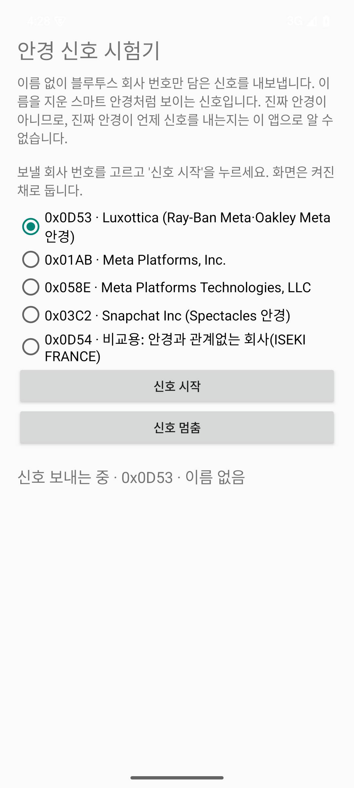
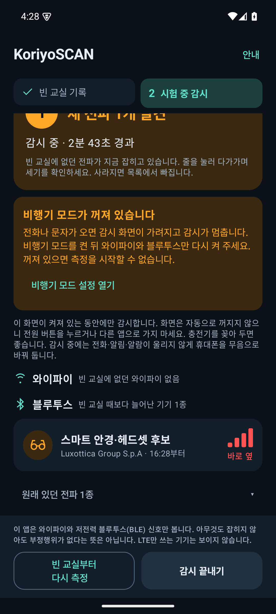

# 안경 신호 시험기 (Glasses Signal Tester)

스마트 안경 없이 **안경 탐지 앱을 시험**하기 위한 Android 앱입니다. 이름 없이 블루투스 회사 번호만 담은 BLE 알림 신호를 내보냅니다. 이름을 지운 Ray-Ban Meta(회사 번호 `0x0D53`, Luxottica)처럼 보이는 신호입니다.

[KoriyoSCAN](https://github.com/reform-dev-team/exam-rf-guard)의 [PR #23](https://github.com/reform-dev-team/exam-rf-guard/pull/23)(안경·헤드셋 회사 번호를 "스마트 안경·헤드셋 후보"로 표시)을 확인하려고 만들었습니다.

<p>
  
  
</p>

왼쪽은 이 앱에서 0x0D53 신호를 켠 화면입니다. 오른쪽은 그 신호를 받은 KoriyoSCAN(PR #23 빌드) 화면입니다. 둘 다 에뮬레이터 화면입니다.

## 이 앱으로 확인할 수 있는 것과 없는 것

- **확인할 수 있는 것:** 그 회사 번호가 담긴 신호가 들어왔을 때 탐지 앱이 어떻게 표시하는지.
- **확인할 수 없는 것:** 진짜 안경이 언제, 어떤 신호를 내보내는지. 이 앱은 진짜 안경이 아닙니다. 예를 들어 휴대폰과 연결된 Ray-Ban Meta 2세대는 신호를 멈춘다는 보고가 있는데, 이런 동작은 안경을 직접 써 봐야 알 수 있습니다.
- 이 앱은 회사 번호를 흉내 내기 쉽다는 것도 보여 줍니다. 탐지 앱의 표시는 후보일 뿐 증거가 아닙니다.

## 쓰는 법 (휴대폰 두 대)

1. **휴대폰 A**에 탐지 앱(예: KoriyoSCAN PR #23 디버그 빌드)을 깔고 빈 교실 기록을 저장합니다.
2. **휴대폰 B**(Android 10 이상)에 이 앱을 깝니다. [Releases](https://github.com/keikang/glasses-signal-tester/releases)의 APK를 받거나 아래처럼 직접 빌드합니다.
3. 휴대폰 B에서 블루투스를 켜고, 이 앱에서 회사 번호를 고른 뒤 **신호 시작**을 누릅니다. 근처 기기 권한을 묻으면 허용합니다.
4. 휴대폰 A에 새 전파가 뜨는지 봅니다. KoriyoSCAN PR #23 빌드라면 `0x0D53`, `0x01AB`, `0x058E`, `0x03C2`는 "스마트 안경·헤드셋 후보"로 뜹니다.
5. **신호 멈춤**을 누르면 휴대폰 A에서 15초 안에 사라집니다. 안경이 휴대폰과 연결되어 신호를 멈춘 상황과 같습니다.
6. 비교하려면 `0x0D54`(안경과 관계없는 회사)를 고릅니다. 새 전파로는 똑같이 뜨지만 안경 표시는 붙지 않습니다.

## 내보내는 신호

| 항목 | 값 |
| --- | --- |
| 제조사 데이터 | 회사 번호 2바이트 + `0x01` 한 바이트 |
| 기기 이름 | 넣지 않음 |
| 연결 | 받지 않음(non-connectable) |
| 세기·간격 | 가장 센 출력, 가장 짧은 간격(LOW_LATENCY) |

회사 번호는 Bluetooth SIG [공식 등록부](https://www.bluetooth.com/specifications/assigned-numbers/)의 값입니다.

## 휴대폰 없이 에뮬레이터 두 대로 시험하기

Android Emulator 37 이상과 Android 15(API 35) 시스템 이미지는 같은 컴퓨터의 에뮬레이터끼리 가상 블루투스를 이어 줍니다. 에뮬레이터 하나에 탐지 앱, 다른 하나에 이 앱을 깔면 같은 순서로 시험할 수 있습니다. 실제 전파가 아니므로 수신률이나 거리는 확인할 수 없습니다.

```shell
emulator -avd phoneA -port 5554 -no-window &
emulator -avd phoneB -port 5556 -no-window &
adb -s emulator-5556 install glasses-signal-tester-1.0.0-debug.apk
```

## 빌드

JDK 17 이상, Android SDK Platform 35가 필요합니다. `local.properties`에 `sdk.dir`을 적습니다.

```shell
./gradlew assembleDebug
```

APK는 `build/outputs/apk/debug/glasses-signal-tester-debug.apk`에 생깁니다.

## English

An Android app for testing smart-glasses detection without real glasses. It broadcasts a BLE advertisement that carries only a chosen Bluetooth company ID (for example `0x0D53`, Luxottica, the maker of Ray-Ban Meta) and no device name. It shows how a detection app labels such a signal; it cannot tell you when real glasses advertise. Built to verify [KoriyoSCAN PR #23](https://github.com/reform-dev-team/exam-rf-guard/pull/23).

## 라이선스

[Apache License 2.0](LICENSE)
